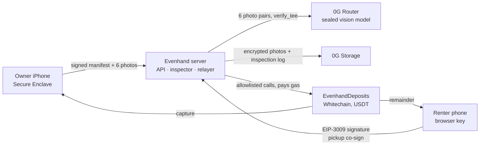

# Evenhand

**A neutral inspector for rental deposits.** Owner and renter photograph the item at pickup and at return. A sealed vision model on **0G** decides whether there is new damage. The deposit sits in **USDT in a Whitechain contract** that neither side controls, and it settles by that verdict: the damage share goes to the owner, the rest goes back to the renter, in one transaction.

> Both sides scan, a sealed AI decides, the deposit settles itself.

Built from scratch at ETHGlobal Mumbai 2026 for the **0G Physical AI** and **Whitechain Operate / Scale** partner prizes.

| | |
|---|---|
| Contract (Whitechain Sepolia, chain 1874) | `TBD` (verified source: TBD) |
| Deposit paid in the official test USDT | `0xcedfB56113143d55b2358b8CFbB0dEB5Ad2f55a7`, example payment: TBD |
| Live pay page / owner dashboard | TBD |
| Demo video | TBD |

## Why it exists

When a deposit is disputed, the side that inspects the item is also the side that keeps the money. AI damage scanners made that faster, not fairer: renters have been billed $300 to $960 for damage they say did not exist, with no immediate way to check the scan. Stablecoin deposits are worse: payments are irreversible and come with no dispute process at all.

Evenhand gives both sides evidence the other accepts and a verdict neither side controls:

- **Evidence from a genuine device.** Six fixed angles, camera only, every photo hashed into a manifest signed by the phone's Secure Enclave key. The renter co-signs the pickup photos.
- **A judge neither side runs.** One sealed 0G vision call compares each pickup/return pair under a static, published rubric. Every decision is logged to 0G Storage with its `request_id`.
- **Money held by neither side.** *A contract that neither party controls holds the deposit, so a neutral verdict is binding on both; a card hold leaves the money with the merchant.*

**Without 0G:** *Without a sealed, attested model, the verdict is the owner's word again.*

## How it works



1. **Deposit.** The owner creates a rental with a damage schedule (for example minor 10%, moderate 35%, major 100%). The renter opens the pay link and taps once. A key made in their browser signs a USDT `receiveWithAuthorization`; the relayer submits it and pays the gas. The renter never sees a wallet, a seed phrase, gas or a chain name.
2. **Pickup.** The owner's iPhone guides six shots of the laptop (screen on a white page, base, both sides, lid, keyboard). The manifest hash goes onchain once the renter confirms the same photos.
3. **Return.** Six more shots, and the return manifest hash goes onchain.
4. **Verdict.** The inspector sends all six pairs to 0G in one call, applies the rules (`RULES_V1`), logs everything to 0G Storage and proposes the verdict onchain with the log's root hash.
5. **Settlement.** After the appeal window anyone can `finalize`. The contract pays the owner and the renter in one transaction.

**Exceptions are first-class:**

| Situation | What happens |
|---|---|
| 0G unreachable or times out | **Inspection paused.** No verdict is produced or guessed; the deposit stays held; retries with backoff |
| Low confidence, an unusable angle, text in a photo, or 0G reports `tee_verified=false` | Routed to a human: the inspector escalates it onchain to the arbiter; nothing settles automatically |
| Automatic capture above 50% of the deposit, or confidence below 0.75 | The contract sends it to the arbiter (`Appealed`) |
| Either side disagrees in the window | Owner or renter can `appeal`; the arbiter settles |
| No verdict by the return deadline + grace | Anyone can trigger a full refund to the renter (for a late return, the grace runs from the return) |
| Item never returned by the deadline + grace | Anyone can `escalate` it to the arbiter; the renter is not refunded automatically |
| Owner changes their mind | The owner can `waive` and release the full deposit at any time |

## 0G: what it does here

- **Decision loop.** Every verdict comes from one `POST /v1/chat/completions` to the 0G Router with `verify_tee: true` and `X-0G-Provider-Trust-Mode: verified`, a static rubric ([`server/src/zg/rubric.ts`](server/src/zg/rubric.ts)), all 12 images, JSON mode, `temperature: 0`. The vision model is picked from `/v1/models` (image input, JSON mode, cheapest first; one stronger second pass only when unsure).
- **Episode log.** Each decision, including the human-routed ones, is written to **0G Storage** as an `InspectionLog`: manifests, encrypted photo roots, model, provider, `request_id`, chat ID, `tee_verified`, rubric hash, raw output of every pass, the decision and billing. Its root hash is stored onchain with the verdict.
- **Replay.** `pnpm -C server replay <root>` downloads a log with Merkle proofs and re-applies the rules to the logged model output, printing the same decision; `--rerun` re-sends the stored photos to 0G.
- **Safe stop.** If 0G is unreachable, the inspection pauses and nothing settles. Paused inspections resume by themselves.

Demo run: request IDs and storage roots are listed in [`docs/spikes/demo-run.md`](docs/spikes/demo-run.md) (TBD).

## Whitechain: what it does here

- **`EvenhandDeposits`** ([`contracts/src/EvenhandDeposits.sol`](contracts/src/EvenhandDeposits.sol)) holds each deposit in the official test USDT and enforces the state machine: `None → Funded → PickedUp → Returned → Proposed/Appealed → Settled`, or `Refunded`. It only ever pays a rental's owner and renter; there is no admin withdrawal and no upgradeability.
- **Gasless for the renter.** The deposit moves with EIP-3009 `receiveWithAuthorization`, which only executes when the contract itself is the caller, so a signature cannot be front-run.
- **Who pays gas, and why the relayer can't be drained.** The business runs two server keys funded with WBT: an inspector key (create, record, propose) and a relayer key (fund, finalize, refund). One `sendTx` helper refuses any other contract or function, caps gas at 500k per transaction, simulates before sending, and sends one transaction per key at a time. No gas is spent when a rental is created. It goes onchain only when a valid, funded authorization arrives, and that authorization is checked offchain first: the EIP-712 signer, the amount, the validity window, the rental-bound nonce, whether the nonce is unused, and the renter's USDT balance. Scans are accepted only from the rental's owner device. Requests are rate-limited to 30 per minute per IP and per device key, and forwarded IPs are trusted only from the local tunnel. A `RELAYER_LOW` warning fires below 1 WBT. (Charging operators a fee per rental to cover gas is v2.)
- **Drop-in for other shops.** [`web/sdk/evenhand.ts`](web/sdk/evenhand.ts) adds Evenhand deposits to any site; the demo shop at `/shop` uses only the SDK, in about 20 lines.
- **For the accountant.** `GET /export.csv?owner=0x…` lists every rental with its deposit, capture, refund, state, tx links, inspection root and 0G request ID.

## Run it

Prerequisites: Node 22, pnpm (via corepack), Foundry. iOS: Xcode on a Mac, and a real iPhone (the Secure Enclave and camera do not work in the simulator).

```sh
pnpm install
pnpm -r build                          # shared, server, web
pnpm -C server test                    # server tests (fake chain, 0G and storage)
cd contracts && forge soldeer install && forge test && cd ..
sh scripts/anvil-e2e.sh                # full flow on a local chain with the real contract
```

| Mode | Command | Needs |
|---|---|---|
| Simulator (fake chain and storage, scripted or real 0G) | `pnpm -C web build && pnpm -C server dev:fake` | nothing |
| Testnet server (API and web on :8787) | `pnpm -C web build && pnpm -C server dev` | `.env` (see `.env.example`) |
| Live 0G check | `pnpm -C server spike:0g` | `ZG_API_KEY`, `ZG_STORAGE_PRIVATE_KEY` |
| Live end to end | `pnpm -C server e2e` | testnet server running, `TEST_RENTER_PRIVATE_KEY` with test USDT |
| Deploy the contract | see [`plan.md`](plan.md), section 9 | `DEPLOYER_PRIVATE_KEY`, `INSPECTOR_PRIVATE_KEY`, `ARBITER_ADDRESS` |

Phones reach the laptop through a tunnel: `cloudflared tunnel --url http://localhost:8787`, then set `PUBLIC_BASE_URL`.

## Repository

| Path | What |
|---|---|
| `contracts/` | `EvenhandDeposits`, Foundry tests, deploy script |
| `server/` | Hono API, inspector pipeline, 0G Router and Storage clients, relayer, keeper |
| `web/` | Renter pay and status pages, owner dashboard, arbiter page, demo shop, SDK (`web/sdk/`) |
| `ios/` | SwiftUI capture app for owner and renter |
| `packages/shared/` | zod schemas, ABI, constants, manifest test fixture |
| `docs/interfaces.md` | The interface spec every part is built from |
| `docs/ai/` | PRD, build prompt and AI-use log (ETHGlobal disclosure) |

## Known limitations

- **The server still sees the photos.** It prepares and forwards them to 0G's sealed inference. Sending photos from the phone straight to sealed inference is the next step.
- **The inspector key is trusted in this version.** Verdicts are accepted from Evenhand's inspector key, bounded by the automatic cap, the confidence threshold and the appeal window. The contract already supports checking the 0G provider's TEE signature over the verdict text (`setTeeSigner`, P1); it stays off until the provider's signed text is confirmed to be the response content.
- **The arbiter is trusted and has no deadline.** Inspections a human must judge, and items never returned, go to the arbiter (`Appealed`). If the arbiter never acts, only the owner's `waive` releases the deposit.
- **The TEE check binds the verdict text, not the inputs.** With `setTeeSigner` on, a stolen inspector key cannot change a signed verdict. But the signature does not cover which photos were sent, and the canonical suffix does not include the chain or contract address.
- **Renter appeals need gas today.** `appeal()` must be sent by the owner or the renter; a signature-based, relayed appeal is planned.
- **Browser keys are not recoverable.** A renter who clears their browser loses the key that receives the refund.
- **One storage root per scan.** The six encrypted photos of a scan are uploaded to 0G Storage as one bundle (faster), not six files.
- **Not handled:** custody and licensing rules for holding deposits, consumer-protection terms, faults that photos cannot show (battery, drive).

## Team

TBD: names, Telegram and X handles.

## AI use

Built with AI coding assistance, documented down to the file in [`docs/ai/AI_USAGE.md`](docs/ai/AI_USAGE.md), alongside the PRD and build prompt in [`docs/ai/`](docs/ai/).

## License

MIT, see [LICENSE](LICENSE).
